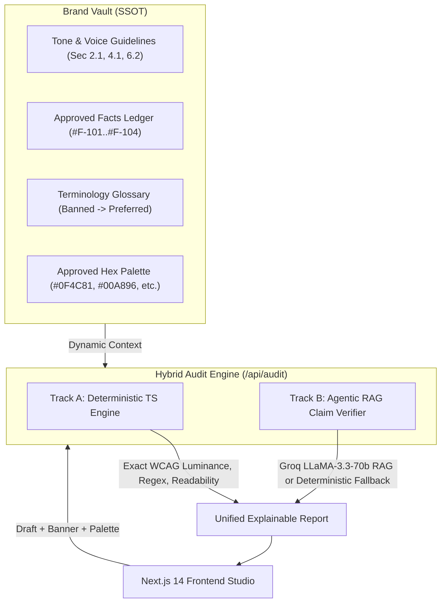

# Seadra Guard — Deterministic & Agentic Brand-Governance Platform

> **Zero-Login MVP** built with **Next.js 14 (App Router)**, **TypeScript**, **Tailwind CSS**, and **Lucide React**.

---

## 🚀 60-Second Hackathon Judge Quickstart

**Seadra Guard** is pre-configured with **ZERO login screens** and **ZERO empty states**. A judge can test the entire workflow end-to-end in under 60 seconds:

```bash
# 1. Start the production or dev server
npm run dev
# or: npm run build && npm start

# 2. Open in your browser:
# http://localhost:3000
```

---

## ⚡ The 60-Second Demo Script for Judges

1. **Open the Homepage (`http://localhost:3000`)**:
   - Notice **"Sample 1: Q4 Cloud Launch Post"** is **automatically pre-loaded and audited**.
   - Notice the **5 Deliberate Violations** flagged in the **Explainable Governance Inspector** (Right Panel) and the low initial **Compliance Score (~18/100)**.
2. **Inspect the Dual-Track Architecture**:
   - Observe the **Engine Badges**:
     - ⚙️ **Deterministic Engine**: Caught banned terminology (`cuts costs by 90%`), WCAG 2.1 contrast violation (`#94A3B8` on `#0F4C81` ratio `3.1:1 < 4.5:1`), and cross-modal discrepancies.
     - 🤖 **Groq Llama-3.3 RAG Agent** (with smart local fallback): Caught hype phrases (`bleeding your company dry`) and false claims against the **Approved Facts Ledger**.
   - Review the exact citations: `Ref: Fact #F-101 & Sec 4.1` and `Ref: Sec 2.1 - Tone & Voice`.
3. **Test 1-Click Remediation**:
   - Click **`[ ✨ Accept 1-Click Fix ]`** on the flag cards.
   - Watch the editor copy, banner text, and banner hex colors automatically update in real time with intent-preserving, verified phrases!
   - Watch the **Compliance Score increase dynamically to 100/100**!
4. **Test Human Override**:
   - Click **`[ Override with Justification ]`** on any flag, type an authorised exception remark, and confirm.
5. **Switch Personas & Complete the Workflow**:
   - In the top navbar, toggle the persona pill from **`[ ✍️ Creator ]`** to **`[ ✅ Reviewer ]`**.
   - In the review thread footer, click **`[ ✅ Approve for Publication ]`** to trigger the celebratory confetti explosion and advance status to `Approved for Publication`.
6. **Customize the Brand Vault**:
   - Switch to the **`[ 📚 Brand Vault ]`** tab.
   - Add a custom empirical fact, custom banned term, or custom brand color hex code — return to the Studio and watch the scanner enforce it instantly!

---

## 🏗️ System Architecture



### 1. Track A: Pure Deterministic Code Engine (Always Pure TS)
- **Mathematical WCAG 2.1 Contrast Ratio**: Computes exact relative luminance:
  $$\text{Luminance } L = 0.2126 \cdot R + 0.7152 \cdot G + 0.0722 \cdot B$$
  $$\text{Contrast Ratio} = \frac{L_1 + 0.05}{L_2 + 0.05}$$
  Flags any combination yielding $< 4.5:1$ (WCAG AA).
- **Approved Brand Palette Enforcement**: Detects non-whitelisted hex codes.
- **Glossary Scan**: Case-insensitive boundary matching for banned words.
- **Flesch-Kincaid Readability**: Analyzes syllable density and flags run-on sentences ($>28$ words).
- **Cross-Modal Consistency**: Scans banner headline against body copy for contradictory numerical percentages.

### 2. Track B: Agentic RAG Claim & Tone Verifier
- Connects to Groq API (`llama-3.3-70b-versatile`, `response_format: { type: "json_object" }`) when `GROQ_API_KEY` is provided.
- **Resilient Fallback**: If no API key is set or the network is blocked, engages an offline heuristic pattern engine so the live hackathon demo **NEVER crashes**.

---

## 🎨 AcmeCloud Pre-Loaded Brand Kit

- **Guidelines**:
  - `[Sec 2.1 - Tone & Voice]`: Objective, enterprise-grade, trustworthy. No hype or artificial urgency.
  - `[Sec 4.1 - Promotional Claims]`: Statistical claims must match Approved Facts Ledger.
  - `[Sec 6.2 - Accessibility & Visuals]`: WCAG 2.1 AA contrast $\ge 4.5:1$ & approved brand hex codes.
- **Approved Facts & Claims Ledger**:
  - `#F-101`: Reduces enterprise cloud server costs by up to 65% (Q3 benchmark).
  - `#F-102`: Guarantees 99.95% SLA uptime across multi-region deployments.
  - `#F-103`: SOC2 Type II and ISO 27001 certified security architecture.
  - `#F-104`: Onboarding and migration completed in under 48 hours for standard clusters.
- **Approved Hex Palette**:
  - `#0F4C81` (Primary Navy)
  - `#1B263B` (Deep Slate)
  - `#00A896` (Teal Accent)
  - `#F8FAFC` (Light Surface)

