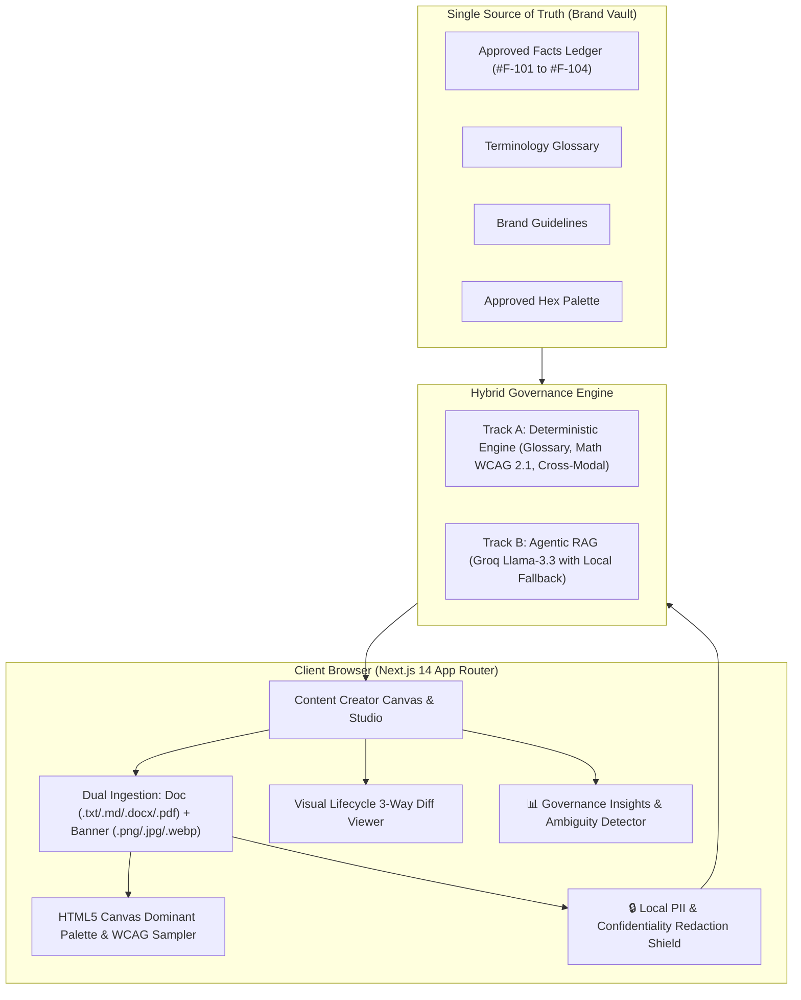

# Seadra Guard — Deterministic & Agentic Multi-Modal Brand Governance Platform

> **Round 3 (The Final Build)** for Codex 48. Built with **Next.js 14 App Router**, **TypeScript**, **Tailwind CSS**, and **Lucide React**.

---

## 🚀 60-Second Hackathon Judge Quickstart

**Seadra Guard** is pre-configured with **ZERO login screens** and **ZERO empty states**. A judge can test the entire workflow end-to-end in under 60 seconds:

```bash
# 1. Start the application
npm run dev
# or for production:
npm run build && npm start

# 2. Open in your browser:
http://localhost:3000
```

---

## 💎 Round 3 (The Final Build) Improvements Implemented

### 1. Multi-Modal File Ingestion & Visual OCR/Palette Extraction
- **Dual-Input Dropzone**:
  - **Document Dropper**: Supports `.txt`, `.md`, `.docx`, and `.pdf` file drops with client-side readers that auto-populate the Draft Editor. Includes 1-click test file buttons (`Drop Q4_Launch.md`, `Drop Security_Notice.docx`).
  - **Banner Dropper**: Supports `.png`, `.jpg`, `.webp` file drops.
- **Client-Side Canvas Dominant Palette Extraction**:
  - Renders image to an off-screen HTML5 `<canvas>` and samples pixel data to extract the top 3 dominant hex colors.
  - Mathematically calculates Euclidean color distance against the Brand Vault approved palette (`#0F4C81`, `#1B263B`, `#00A896`, `#F8FAFC`).
  - Calculates WCAG 2.1 AA mathematical contrast ratio between the primary foreground text and background.
- **Vision / Banner Text OCR & Cross-Modal Verifier**:
  - Extracts text from the uploaded banner graphic.
  - Cross-references metrics in extracted banner text against body copy and Approved Facts Ledger (`#F-101` to `#F-104`).
  - Flags high-priority `CROSS_MODAL_DISCREPANCY` (e.g. Banner promises *"Save 90%"* while body text says *"reduces costs by up to 65%"*).

---

### 2. Governance Intelligence & "Guideline Ambiguity Detector" Dashboard
- Dedicated top navbar tab: **`[ 📊 Governance Insights ]`**.
- Executive enterprise analytics dashboard:
  1. **Compliance Velocity & Health Metrics**:
     - Average Brand Governance Score over recent scans (`84.6%` avg score, `+12.4%` velocity).
     - Violation Category Distribution breakdown (`Unsupported Claims 42%`, `WCAG Contrast 28%`, `Tone Drift 18%`, `Terminology 12%`) rendered as visual progress bars.
  2. **Guideline Ambiguity Detector**:
     - Tracks telemetry on Human Reviewer Overrides per guideline section.
     - Calculates Override Rate: `(Overrides / Total Flags) * 100`.
     - High-visibility alert card rendered when override rate exceeds 50%:
       > **⚠️ Guideline Ambiguity Detected in Sec 2.1 (Tone & Voice):**  
       > Human reviewers override this flag 65% of the time with remarks citing *'context-dependent phrasing'*.  
       > *Recommendation: Clarify clause boundaries in Brand Book to eliminate reviewer fatigue.*
     - **1-Click Refine Action**: `[ ⚡ Refine Guideline in Brand Vault ]` switches directly to Brand Vault with pre-filled clarification ready to apply.

---

### 3. Confidentiality Redaction Shield & Visual Side-by-Side Diff Viewer
- **Local PII & Confidentiality Redaction Shield**:
  - Prominent top navbar toggle: **`[ 🔒 Shield: ACTIVE ]`** (Enabled by default).
  - Client-side pre-inference sanitizer: automatically scans and masks email addresses, phone numbers, API keys, and unreleased project names (`Project Orion` -> `[CONFIDENTIAL_PROJECT]`) BEFORE sending payloads to external LLM APIs.
  - Live inspector badge: *"Shield Active: X Sensitive Tokens Locally Redacted"*.
- **Visual Git-Style Side-by-Side Diff Viewer**:
  - In Authorised Reviewer mode, click **`[ ⇄ View Revision Diff ]`**.
  - Modal with 3-column split or unified changelog comparing:
    - **Original Creator Draft** (red strikethrough for deleted text)
    - **AI Suggested Remediation** (blue highlight for replacements)
    - **Final Approved Version** (green highlight for approved phrasing)
  - Allows reviewers to inspect every single word before clicking **`[ ✅ Approve for Publication ]`**.

---

### 4. Bulletproof Reliability & Judge Proofing
- **Empty State Handling**: If copy is completely cleared and "Run Audit" is clicked, does not crash or hang; displays inline helper: *"Please type draft copy, select a sample preset, or drop a file to run audit."*
- **Rapid Click Protection**: Buttons disable during audit execution (`disabled={isAuditing}`) with inline spinning indicator to prevent duplicate flags.
- **Zero-Login Continuity**: Reloading `http://localhost:3000` always re-hydrates Sample 1 instantly with 5 deliberate violations pre-audited.
- **Offline Fallback Guarantee**: Runs flawlessly even if `GROQ_API_KEY` is not set or network times out.

---

## 🏗️ Architecture Overview



---

## 📜 License
MIT — Seadra Guard © 2026.
